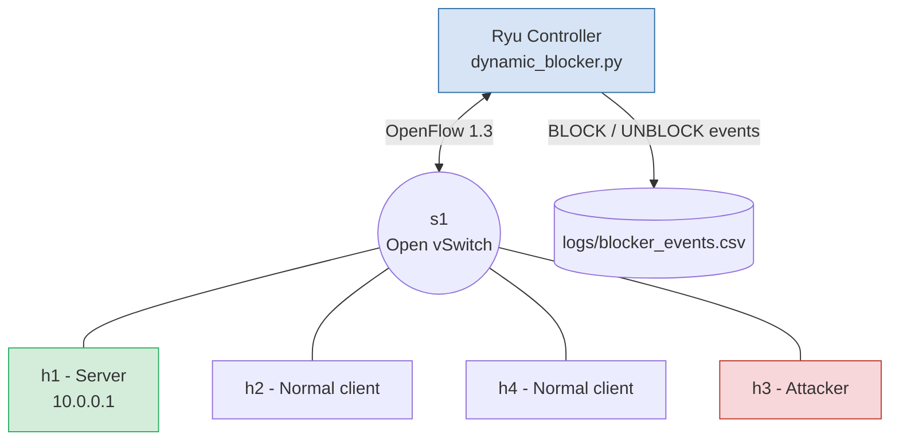
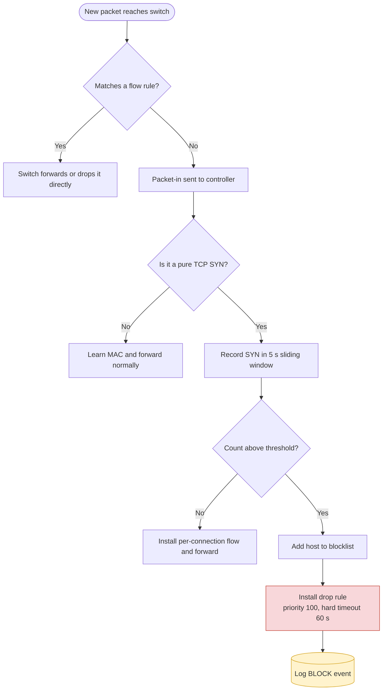
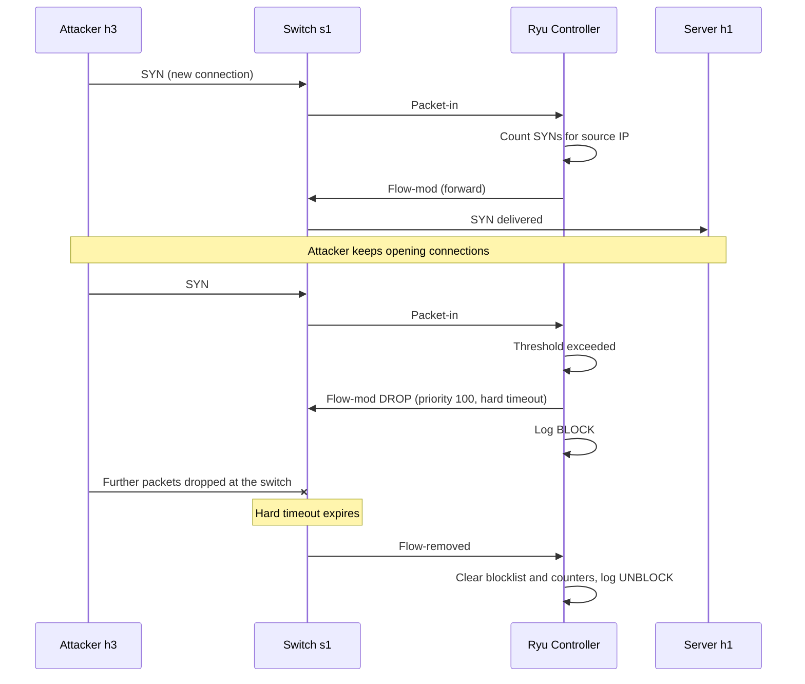
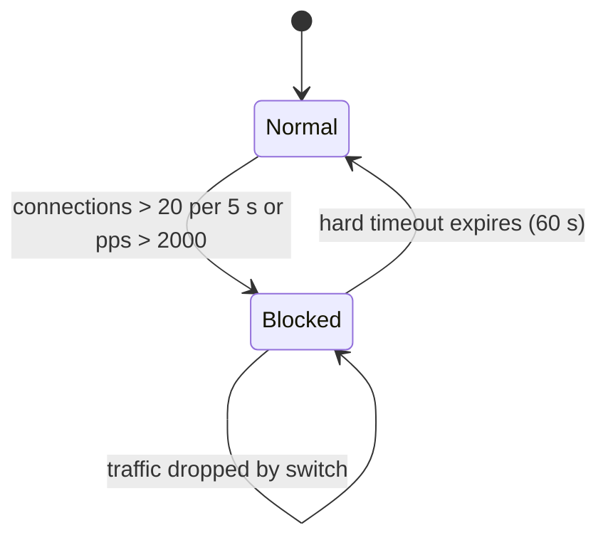
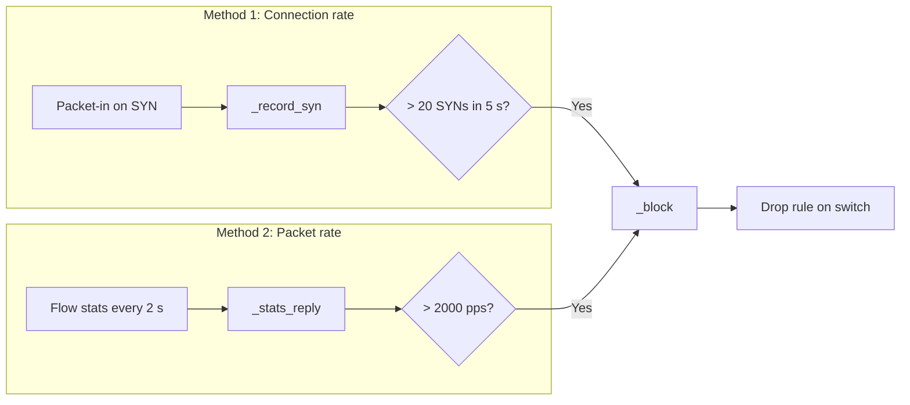

[PROJECT_SUMMARY.md](https://github.com/user-attachments/files/35087581/PROJECT_SUMMARY.md)
# Dynamic Host Blocking System (SDN)

An SDN controller application that **detects abnormal TCP traffic and automatically blocks suspicious hosts** using OpenFlow drop rules. Built with **Mininet**, **Open vSwitch** and the **Ryu** controller (OpenFlow 1.3).

---

## 1. The Problem

Traditional networks rely on manually configured firewalls. A single host opening hundreds of TCP connections (for example a SYN flood or aggressive scanner) can overwhelm a server before an administrator reacts.

In **Software-Defined Networking (SDN)** the control logic is separated from the switches. A central controller sees traffic and can program the switches in real time. This project uses that ability to **detect an attacker and block it automatically**, then **unblock it after a timeout**.

---

## 2. Architecture



| Layer | Component | Role |
|-------|-----------|------|
| Control plane | Ryu app (`dynamic_blocker.py`) | Learns MACs, detects attacks, installs and removes rules |
| Data plane | Open vSwitch (`s1`) | Forwards packets and enforces drop rules |
| Emulation | Mininet (`topo.py`) | Builds the virtual network |

---

## 3. How It Works

1. **Packet-in:** the first packet (SYN) of every new TCP connection is sent to the controller.
2. **Connection counting:** the controller counts SYNs per source IP in a **5-second sliding window**.
3. **Rate monitoring:** a background thread polls flow statistics every **2 s** and computes **packets per second** per host.
4. **Detection:** if a host exceeds a threshold (default **> 20 new connections / 5 s** or **> 2000 pps**), it is added to a dynamic blocklist and a **priority-100 drop rule** is installed.
5. **Auto-unblock:** the rule has a **hard timeout** (default 60 s). When it expires the host is removed from the blocklist.
6. **Logging:** every `BLOCK` / `UNBLOCK` event is written to `logs/blocker_events.csv`.

### Detection flow



### Interaction between components



### Host lifecycle



---

## 4. Project Files

| File | Purpose |
|------|---------|
| `dynamic_blocker.py` | Ryu controller app: switching, detection, blocking, unblocking, logging |
| `topo.py` | Mininet topology: `s1` with `h1` (server), `h2`/`h4` (normal), `h3` (attacker) |
| `tcp_server.py` | Multi-threaded TCP server (the victim) |
| `client.py` | TCP traffic generator (normal or attack rate) |
| `run_tests.py` | Automated system tests (13 test cases) |

---

## 5. Code Walkthrough (`dynamic_blocker.py`)

| Function | What it does |
|----------|--------------|
| **Config constants** | Thresholds, window, block time and whitelist; overridable via environment variables |
| `_features` | Installs the table-miss rule so unknown packets go to the controller |
| `_packet_in` | Learns MACs, forwards packets, detects pure SYN packets and installs a per-connection (5-tuple) flow so each new connection reaches the controller. Non-TCP traffic gets no flow, otherwise a generic flow would hide TCP connections from the controller |
| `_record_syn` | Sliding-window SYN counter per source IP; blocks the host when the count exceeds the threshold |
| `_block` | Adds the IP to the blocklist and installs a drop flow (priority 100, match `ipv4_src`, empty actions) on all switches with a hard timeout |
| `_flow_removed` | When the drop rule expires, removes the host from the blocklist, resets counters and logs `UNBLOCK` |
| `_monitor` / `_stats_reply` | Polls flow stats, sums packet-count differences per source IP, computes pps and blocks hosts above the pps threshold |
| `_log` | Writes events to the CSV log and the Ryu logger |

### Two detection methods



The two methods complement each other: the first catches many short connections (SYN flood or scan), the second catches high-volume traffic over established flows.

---

## 6. Setup (Ubuntu 20.04)

```bash
sudo apt install -y mininet openvswitch-switch python3-pip hping3
pip3 install ryu eventlet==0.30.2
```

## 7. Running the Project

### Manual demo

```bash
# Terminal 1 - start the controller
ryu-manager dynamic_blocker.py

# Terminal 2 - start the network
sudo python3 topo.py
```

Then inside the Mininet CLI:

```bash
# Normal client: all connections succeed
mininet> h2 python3 client.py 10.0.0.1 80 10 0.5

# Attacker: gets blocked
mininet> h3 python3 client.py 10.0.0.1 80 60 0.02 0.2

# Inspect the drop rule on the switch
mininet> sh ovs-ofctl -O OpenFlow13 dump-flows s1
```

### Automated tests

```bash
sudo mn -c
BLOCK_TIME=15 ryu-manager dynamic_blocker.py   # terminal 1
sudo python3 run_tests.py                      # terminal 2  -> 13/13 passed
```

---

## 8. Configuration

All values can be overridden with environment variables:

| Variable | Meaning | Default |
|----------|---------|---------|
| `WINDOW` | Sliding window length for SYN counting | 5 s |
| `CONN_THRESHOLD` | Max new connections per window | 20 |
| `PPS_THRESHOLD` | Max packets per second | 2000 |
| `POLL_INTERVAL` | Flow-stats polling interval | 2 s |
| `BLOCK_TIME` | Hard timeout of the drop rule | 60 s |
| `WHITELIST` | Hosts that are never blocked | - |
| `BLOCK_LOG` | Path of the CSV event log | `logs/blocker_events.csv` |

Example:

```bash
CONN_THRESHOLD=50 BLOCK_TIME=30 ryu-manager dynamic_blocker.py
```

---

## 9. Limitations and Future Work

- **Single switch** only; no multi-switch topologies tested.
- **Source-IP based**; IP spoofing is not handled.
- **Static thresholds**; no adaptive or learning-based detection.
- **ARP** from a blocked host is still forwarded.

Possible improvements: adaptive thresholds, per-port or per-subnet rate limiting, multi-switch support, and a dashboard for the event log.

---

## 10. Team

Developers: `<Shreyas Holla-PES1UG25AM381>`, `<Swayam R-PES1UG25AM420>` | Tester: `<Siddharth Manjunath-PES1UG25AM392>` | 
